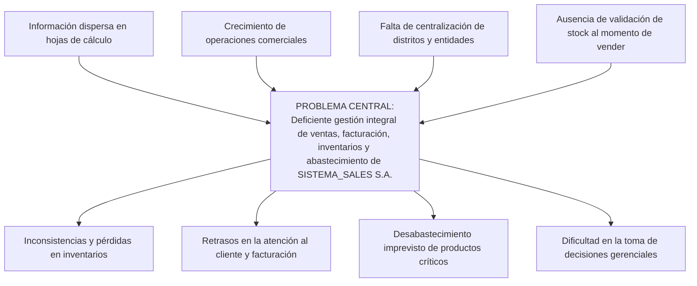

# INSTITUTO SUPERIOR TECNOLÓGICO JAPÓN
### VICERRECTORADO DE INVESTIGACIÓN Y VINCULACIÓN
**CARRERA:** TECNOLOGÍA SUPERIOR EN DESARROLLO DE SOFTWARE  
**CÓDIGO DEL CASO:** VIV-ISUJ-FDC-2025-01  
**TEMA:** Desarrollo de un Sistema de Información para la Gestión Integral de Ventas, Facturación, Inventarios y Procesos de Abastecimiento en la Empresa SISTEMA_SALES S. A., en la ciudad de Quito, Ecuador.  
**ESTUDIANTE:** Karina Violeta Figueroa Vergara  
**DOCENTES GUÍA:** Msc. Graciela Trujillo / Ing. Luis Calo  
**ASIGNATURA:** Trabajo de Titulación (Cuarto Semestre)  
**FECHA:** Septiembre 2026 • Quito – Ecuador  

---

## RESUMEN EJECUTIVO
El presente proyecto implementa la solución informática integral para la empresa **SISTEMA_SALES S.A.**, ubicada en la ciudad de Quito, Ecuador (Av. Los Shyris, Edificio Argentun, piso 10). La empresa se dedica a la comercialización de productos tecnológicos y suministros al por mayor y menor. Debido al aumento continuo en el volumen de operaciones comerciales y abastecimiento, la organización presentaba demoras administrativas, inconsistencias en el seguimiento de stock y dispersión de datos.

La solución desarrollada se basa en una arquitectura cliente-servidor de tres capas:
1. **Base de Datos Relacional:** Implementada en **MySQL Workbench** bajo el esquema `sistema_sales`, con restricciones de integridad referencial, vistas para reportes analíticos, procedimientos almacenados y triggers automáticos para el control de inventario no negativo y reabastecimiento.
2. **Capa de Negocio (Backend):** Desarrollada con **Python** y el framework **Django REST Framework**, exponiendo servicios web API (JSON) para la sincronización centralizada de datos.
3. **Capa de Presentación Multiplataforma:** Compuesta por un cliente Web interactivo (HTML5/CSS3/JavaScript moderno compatible con React), cliente de escritorio diseñado en **Flutter para Windows** y módulo móvil estructurado en **Expo con React Native**.

---

## CAPÍTULO I. PLANTEAMIENTO DEL PROBLEMA
### 1.1 Contextualización de la Empresa
SISTEMA_SALES S.A. cuenta con un Departamento de Tecnología conformado por:
- 1 Jefe de Sistemas
- 1 Administrador de Base de Datos (DBA)
- 1 Analista de Sistemas
- 2 Desarrolladores de Software
- 1 Pasante

### 1.2 Situación Problemática
La falta de un sistema unificado generaba:
- Descoordinación entre las ventas registradas y el stock físico real en bodega.
- Falta de alertas tempranas cuando los productos alcanzan su stock mínimo de seguridad.
- Tiempos elevados en la elaboración de órdenes de compra a proveedores.
- Dificultad para auditar y consultar facturas históricas con su desglose de IVA (15% vigente en Ecuador).
- Dispersión geográfica en la categorización de clientes, proveedores y vendedores en los distritos metropolitanos de Quito.

### 1.3 Árbol del Problema

### 1.4 Objetivos
- **Objetivo General:** Desarrollar una solución informática multiplataforma para la gestión integral de ventas, facturación, inventarios y procesos de abastecimiento de la empresa SISTEMA_SALES S.A., mediante aplicaciones de escritorio, web y móvil conectadas a un backend centralizado y una base de datos relacional en MySQL Workbench.
- **Objetivos Específicos:**
  1. Diseñar el modelo relacional normalizado con integridad referencial y disparadores de inventario.
  2. Implementar los servicios REST en Django para las reglas de negocio y control de acceso por roles.
  3. Desarrollar interfaces accesibles e intuitivas con paneles ejecutivos (Dashboard) idénticos a los requerimientos institucionales.
  4. Garantizar la trazabilidad de órdenes de compra, abastecimiento y facturación electrónica.

---

## CAPÍTULO II. ESTUDIO DE FACTIBILIDAD
1. **Factibilidad Técnica:** El proyecto aprovecha tecnologías de código abierto maduras y probadas: Python 3, Django, MySQL Server 8.0, HTML5/CSS3/JS, Flutter y Expo/React Native. El personal del Departamento de TI de la empresa dispone de las competencias necesarias para su mantenimiento.
2. **Factibilidad Económica:** Al sustentarse sobre software libre y licenciamiento open source, no se incurre en costos elevados de licencias privativas. El retorno sobre la inversión (ROI) se evidencia en la reducción del 80% de tiempos administrativos y eliminación de mermas de inventario.
3. **Factibilidad Operativa:** El sistema cuenta con perfiles delimitados:
   - *Administrador:* Control total del sistema, catálogos y reportería.
   - *Vendedor:* Búsqueda de clientes, consulta de stock y emisión de facturas.
   - *Personal de Compras:* Gestión de proveedores, emisión y recepción de órdenes de compra.
   - *Personal Administrativo:* Consultas y auditoría de comprobantes.
4. **Factibilidad Temporal:** El cronograma de 15 semanas estructurado bajo Scrum cubrió desde el análisis y diseño hasta las pruebas de integración y elaboración de manuales.

---

## CAPÍTULO III. REQUERIMIENTOS Y REGLAS DE NEGOCIO
### Requerimientos Funcionales (RF01 - RF18)
- **RF01 (Autenticación):** Acceso seguro mediante usuario y clave con validación de estado activo.
- **RF02 (Gestión de Usuarios):** Mantenimiento de cuentas y asignación de roles.
- **RF03 (Gestión de Distritos):** Mantenimiento del catálogo territorial de parroquias y distritos de Quito.
- **RF04 (Gestión de Clientes):** Registro de clientes con validación de RUC de 13 dígitos.
- **RF05 (Gestión de Proveedores):** Registro de casas mayoristas con representante legal y contacto.
- **RF06 (Gestión de Vendedores):** Registro de personal de ventas con sueldo en USD y tipo contractual.
- **RF07 (Gestión de Productos):** Registro con precio, stock físico, umbral mínimo, marca y línea.
- **RF08 (Control de Inventario):** Consulta y actualización de existencias en tiempo real.
- **RF09 (Control de Stock Mínimo):** Detección visual y lógica de productos con existencias $\le$ stock mínimo.
- **RF10 (Registro de Facturas):** Emisión con número único, cliente, vendedor, fecha y cálculo de IVA.
- **RF11 (Detalle de Factura):** Adición de líneas de producto con validación de existencias.
- **RF12 (Órdenes de Compra):** Emisión de solicitudes a proveedores con estado Pendiente/Atendida.
- **RF13 (Detalle de Orden):** Registro de cantidades solicitadas por producto.
- **RF14 (Abastecimiento):** Parametrización de precios de compra por proveedor para cálculo de márgenes.
- **RF15 (Consultas):** Filtros dinámicos por línea de producto, marca, RUC y estados.
- **RF16 (Reportes):** Ranking de ventas por vendedor, productos críticos y totales recaudados.
- **RF17 (Trazabilidad):** Registro cronológico del origen y estados de cada comprobante.
- **RF18 (Sincronización):** Persistencia única y centralizada para clientes web, desktop y mobile.

### Reglas de Negocio (RN01 - RN14)
- **RN01:** Todo cliente debe pertenecer obligatoriamente a un distrito.
- **RN02:** Todo proveedor debe estar vinculado a un distrito.
- **RN03:** Todo vendedor debe registrar su distrito de residencia.
- **RN04:** Una factura de venta debe pertenecer a un cliente registrado.
- **RN05:** Una factura debe ser emitida por un vendedor registrado.
- **RN06:** Toda factura debe contener al menos un detalle de producto.
- **RN07:** Cada detalle de factura corresponde a un producto del catálogo.
- **RN08:** Una orden de compra debe ser emitida a un proveedor válido.
- **RN09:** Una orden de compra debe contener al menos un producto solicitado.
- **RN10:** Cada detalle de orden corresponde a un producto existente.
- **RN11:** El stock actual de un producto nunca puede ser negativo.
- **RN12:** La cantidad solicitada en una orden de compra debe ser estrictamente mayor a 0.
- **RN13:** El precio de venta al público debe ser estrictamente mayor a 0.
- **RN14:** Los registros con operaciones vinculadas no se eliminan físicamente; se conservan mediante estados o anulación lógica.

---

## CAPÍTULO IV. METODOLOGÍA SCRUM
Se estructuraron 7 Sprints de dos semanas:
- **Sprint 1:** Análisis de factibilidad, modelo de datos y diseño inicial.
- **Sprint 2:** Módulos de Distritos, Clientes, Proveedores y Vendedores.
- **Sprint 3:** Catálogo de Productos, Control de Inventario y Alertas de Stock Mínimo.
- **Sprint 4:** Módulo de Facturación, Detalle de Venta y liquidación de IVA.
- **Sprint 5:** Órdenes de Compra, Matriz de Abastecimiento y Recepción de Mercadería.
- **Sprint 6:** Interfaces de usuario (Web React/HTML5, Desktop Flutter, Mobile Expo).
- **Sprint 7:** Integración con MySQL, pruebas funcionales, seguridad y documentación.

---

## CAPÍTULO V. MODELADO UML
Consulte los diagramas detallados en `docs/03_MODELADO_UML_Y_CASOS_DE_USO.md`.

---

## CAPÍTULO VI. DISEÑO DE BASE DE DATOS
La base de datos relacional `sistema_sales` cuenta con 11 tablas normalizadas en Tercera Forma Normal (3FN), optimizada para MySQL Workbench.
Consulte el archivo: `database/sistema_sales_mysql.sql`.

---

## CAPÍTULO VII. ARQUITECTURA DEL SISTEMA
Arquitectura cliente-servidor de 3 capas:
1. **Presentación:** Interfaces desacopladas que se comunican vía JSON REST.
2. **Lógica de Negocio:** Django con autenticación, validación atómica y transacciones.
3. **Persistencia:** Servidor de base de datos MySQL con almacenamiento transaccional InnoDB.
