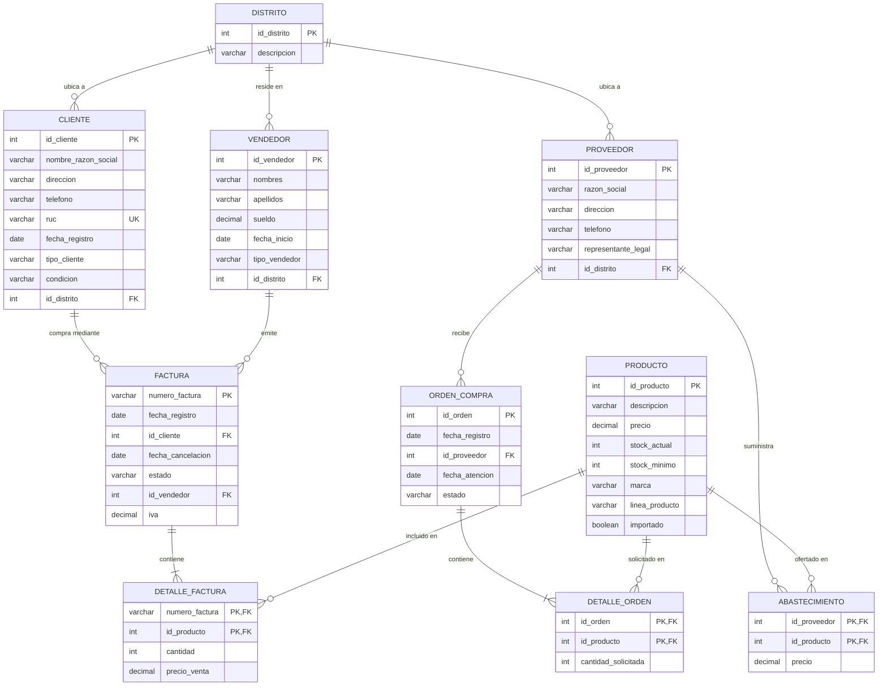

# DICCIONARIO DE DATOS Y MODELO ENTIDAD-RELACIÓN
### SISTEMA_SALES S.A. • Base de Datos MySQL Workbench

## 1. MODELO ENTIDAD-RELACIÓN (MER) - DIAGRAMA MERMAID

---

## 2. DICCIONARIO DE DATOS DETALLADO (CAPÍTULO 6.4)

### 2.1 TABLA: DISTRITO
| Campo | Tipo de Dato | Clave | Nulo | Descripción |
|---|---|---|---|---|
| `id_distrito` | INT AUTO_INCREMENT | PK | NO | Identificador único del distrito/parroquia |
| `descripcion` | VARCHAR(100) | - | NO | Nombre del distrito en la ciudad de Quito |

### 2.2 TABLA: CLIENTE
| Campo | Tipo de Dato | Clave | Nulo | Descripción |
|---|---|---|---|---|
| `id_cliente` | INT AUTO_INCREMENT | PK | NO | Identificador numérico del cliente |
| `nombre_razon_social` | VARCHAR(150) | - | NO | Nombres y apellidos o razón social jurídica |
| `direccion` | VARCHAR(200) | - | NO | Dirección comercial o domiciliaria |
| `telefono` | VARCHAR(20) | - | NO | Teléfono fijo o móvil de contacto |
| `ruc` | VARCHAR(13) | UNIQUE | NO | Número de RUC o Cédula (13 dígitos Ecuador) |
| `fecha_registro` | DATE | - | NO | Fecha de alta en el sistema |
| `tipo_cliente` | VARCHAR(50) | - | NO | Mayorista, Minorista, Corporativo, Final |
| `condicion` | VARCHAR(50) | - | NO | Estado de cliente: Activo, Inactivo, Moroso |
| `id_distrito` | INT | FK | NO | Referencia a DISTRITO (RN01) |

### 2.3 TABLA: PROVEEDOR
| Campo | Tipo de Dato | Clave | Nulo | Descripción |
|---|---|---|---|---|
| `id_proveedor` | INT AUTO_INCREMENT | PK | NO | Identificador único del proveedor |
| `razon_social` | VARCHAR(150) | - | NO | Razón social de la empresa proveedora |
| `direccion` | VARCHAR(200) | - | NO | Dirección de las instalaciones de la empresa |
| `telefono` | VARCHAR(20) | - | NO | Teléfono de contacto comercial |
| `representante_legal` | VARCHAR(150) | - | NO | Nombre del representante legal de la empresa |
| `id_distrito` | INT | FK | NO | Referencia a DISTRITO (RN02) |

### 2.4 TABLA: VENDEDOR
| Campo | Tipo de Dato | Clave | Nulo | Descripción |
|---|---|---|---|---|
| `id_vendedor` | INT AUTO_INCREMENT | PK | NO | Identificador del vendedor comercial |
| `nombres` | VARCHAR(100) | - | NO | Nombres completos del colaborador |
| `apellidos` | VARCHAR(100) | - | NO | Apellidos completos del colaborador |
| `sueldo` | DECIMAL(10,2) | - | NO | Sueldo base mensual expresado en USD |
| `fecha_inicio` | DATE | - | NO | Fecha de inicio de labores en la empresa |
| `tipo_vendedor` | VARCHAR(50) | - | NO | Modalidad: Planta, Comisionista, Senior, Junior |
| `id_distrito` | INT | FK | NO | Distrito de residencia asignado (RN03) |

### 2.5 TABLA: PRODUCTO
| Campo | Tipo de Dato | Clave | Nulo | Descripción |
|---|---|---|---|---|
| `id_producto` | INT AUTO_INCREMENT | PK | NO | Identificador único del producto |
| `descripcion` | VARCHAR(200) | - | NO | Descripción comercial y técnica del producto |
| `precio` | DECIMAL(10,2) | - | NO | Precio de venta al público en USD (RN13) |
| `stock_actual` | INT | - | NO | Existencias físicas reales en bodega (RN11) |
| `stock_minimo` | INT | - | NO | Umbral mínimo para alerta de reposición (RF09) |
| `marca` | VARCHAR(100) | - | NO | Marca comercial del fabricante |
| `linea_producto` | VARCHAR(100) | - | NO | Línea/Familia (Laptops, Redes, Impresión, etc.) |
| `importado` | BOOLEAN | - | NO | 1 si es producto importado, 0 si es nacional |

### 2.6 TABLA: FACTURA
| Campo | Tipo de Dato | Clave | Nulo | Descripción |
|---|---|---|---|---|
| `numero_factura` | VARCHAR(30) | PK | NO | Código de factura e.g. FAC-001-001-0000001 |
| `fecha_registro` | DATE | - | NO | Fecha de emisión de la transacción comercial |
| `id_cliente` | INT | FK | NO | Cliente que realiza la compra (RN04) |
| `fecha_cancelacion` | DATE | - | SÍ | Fecha en que se salda el valor de la factura |
| `estado` | VARCHAR(30) | - | NO | Estado de factura: EMITIDA, PAGADA, ANULADA |
| `id_vendedor` | INT | FK | NO | Vendedor responsable de la venta (RN05) |
| `iva` | DECIMAL(5,2) | - | NO | Porcentaje de IVA legal (15.00 en Ecuador) |

### 2.7 TABLA: DETALLE_FACTURA
| Campo | Tipo de Dato | Clave | Nulo | Descripción |
|---|---|---|---|---|
| `numero_factura` | VARCHAR(30) | PK, FK | NO | Referencia a la FACTURA cabecera (RN06) |
| `id_producto` | INT | PK, FK | NO | Referencia al PRODUCTO comercializado (RN07) |
| `cantidad` | INT | - | NO | Cantidad vendida de unidades |
| `precio_venta` | DECIMAL(10,2) | - | NO | Precio unitario aplicado a la venta |

### 2.8 TABLA: ORDEN_COMPRA
| Campo | Tipo de Dato | Clave | Nulo | Descripción |
|---|---|---|---|---|
| `id_orden` | INT AUTO_INCREMENT | PK | NO | Identificador único de orden de abastecimiento |
| `fecha_registro` | DATE | - | NO | Fecha en que se genera la orden |
| `id_proveedor` | INT | FK | NO | Proveedor al que se le solicita la orden (RN08) |
| `fecha_atencion` | DATE | - | SÍ | Fecha en que la mercadería es entregada y recibida |
| `estado` | VARCHAR(30) | - | NO | Estado: PENDIENTE, ATENDIDA, CANCELADA |

### 2.9 TABLA: DETALLE_ORDEN
| Campo | Tipo de Dato | Clave | Nulo | Descripción |
|---|---|---|---|---|
| `id_orden` | INT | PK, FK | NO | Referencia a la ORDEN_COMPRA cabecera (RN09) |
| `id_producto` | INT | PK, FK | NO | Referencia al PRODUCTO solicitado (RN10) |
| `cantidad_solicitada` | INT | - | NO | Unidades pedidas al proveedor (> 0, RN12) |

### 2.10 TABLA: ABASTECIMIENTO
| Campo | Tipo de Dato | Clave | Nulo | Descripción |
|---|---|---|---|---|
| `id_proveedor` | INT | PK, FK | NO | Proveedor que ofrece el precio de costo |
| `id_producto` | INT | PK, FK | NO | Producto vinculado al proveedor |
| `precio` | DECIMAL(10,2) | - | NO | Precio de costo mayorista pactado en USD |

### 2.11 TABLA: USUARIO
| Campo | Tipo de Dato | Clave | Nulo | Descripción |
|---|---|---|---|---|
| `id_usuario` | INT AUTO_INCREMENT | PK | NO | Identificador único del usuario del sistema |
| `username` | VARCHAR(50) | UNIQUE | NO | Nombre de usuario para inicio de sesión |
| `password_hash` | VARCHAR(255) | - | NO | Hash cifrado de contraseña (RF01) |
| `nombre_completo` | VARCHAR(150) | - | NO | Nombres y apellidos del usuario |
| `email` | VARCHAR(100) | UNIQUE | NO | Correo electrónico institucional |
| `rol` | VARCHAR(30) | - | NO | Administrador, Vendedor, Compras, Administrativo |
| `estado` | VARCHAR(20) | - | NO | ACTIVO o INACTIVO |
| `ultimo_acceso` | DATETIME | - | SÍ | Registro de auditoría del último inicio de sesión |
