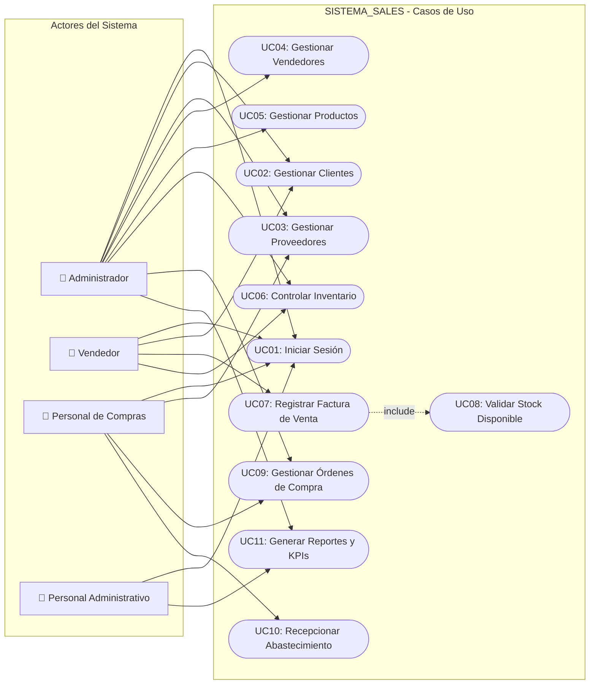
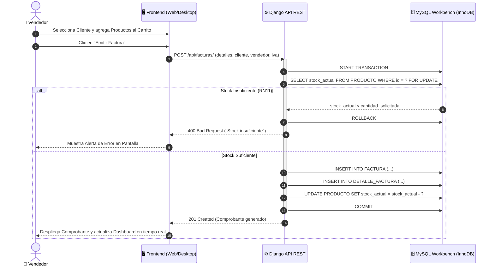
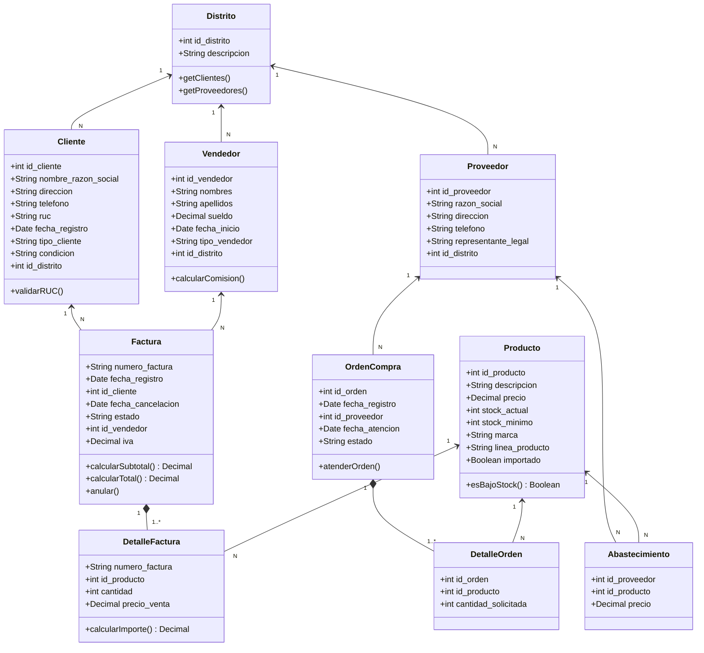

# MODELADO UML DEL SISTEMA DE INFORMACIÓN
### SISTEMA_SALES S.A. • Capítulo V del Caso Práctico

## 1. DIAGRAMA DE CASOS DE USO (FIGURA 1 DE LA TESIS)
Ilustra los actores principales identificados en la empresa (Administrador, Vendedor, Personal de Compras y Personal Administrativo) y sus interacciones con los módulos del sistema.

---

## 2. DIAGRAMA DE SECUENCIA: PROCESO DE FACTURACIÓN CON VALIDACIÓN DE STOCK
Representa la interacción paso a paso entre el Cliente, la Interfaz de Usuario, el Backend Django y la Base de Datos MySQL:

---

## 3. DIAGRAMA DE CLASES DEL DOMINIO (FIGURA 2 DE LA TESIS)
Estructura orientada a objetos implementada en el Backend Django y modelos relacionales:

